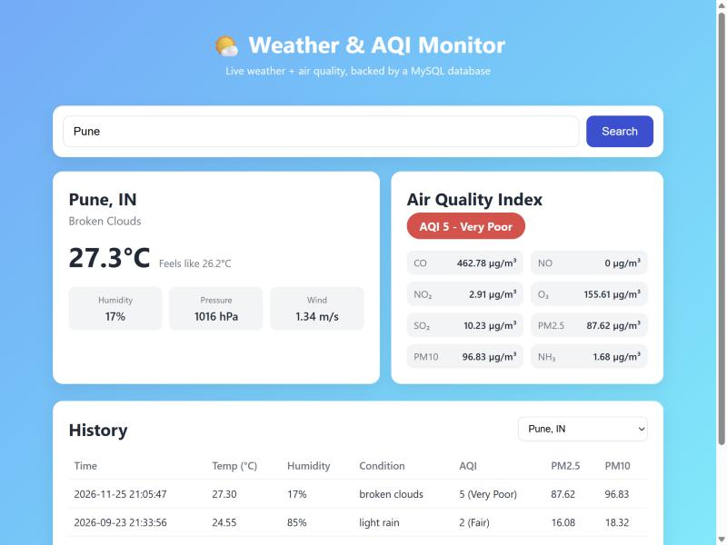
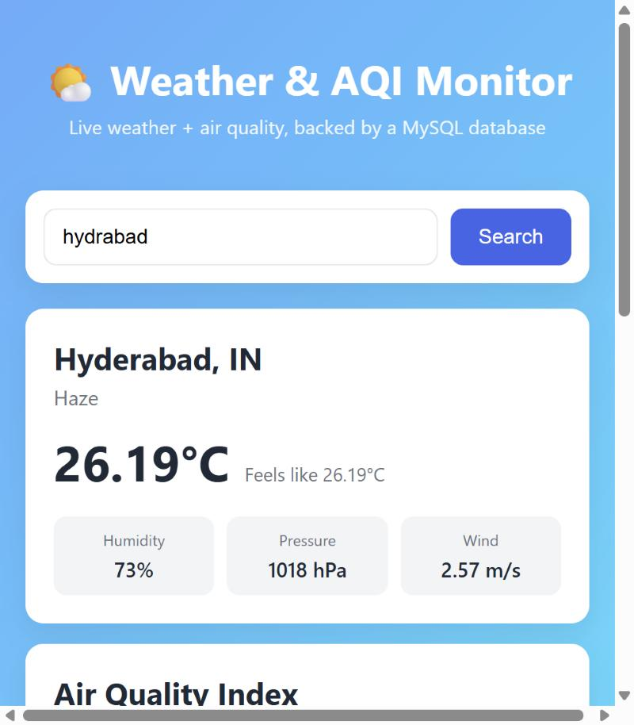
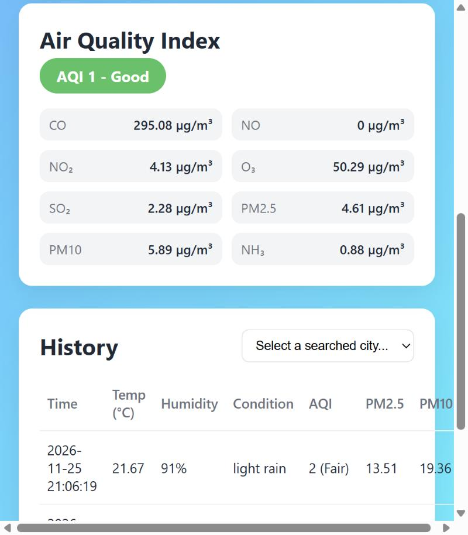

# Weather & AQI Monitor (DBMS Mini Project)

Flask + MySQL backend that fetches live weather and air-quality data from
OpenWeatherMap and stores every reading in MySQL, with a simple HTML/CSS/JS frontend.

## Screenshots

| Search + current weather | Weather card | AQI + history |
|---|---|---|
|  |  |  |

## Tables
- `cities` — unique city + coordinates
- `weather_data` — one row per fetch (temp, humidity, wind, etc.), FK -> cities
- `aqi_data` — one row per fetch (AQI + pollutant levels), FK -> cities

## Setup

1. **Create the database**
   ```
   mysql -u root -p < schema.sql
   ```

2. **Set DB credentials**
   Copy `config.example.py` to `config.py`, then edit `DB_CONFIG` (user/password)
   to match your MySQL install and fill in your own OpenWeatherMap API key.
   `config.py` is git-ignored so your secrets never get committed.

3. **Install dependencies**
   ```
   pip install -r requirements.txt
   ```

4. **Run the app**
   ```
   python app.py
   ```
   Open http://127.0.0.1:5000 in your browser.

## How it works
1. Type a city name and click Search.
2. Flask calls OpenWeatherMap's Geocoding, Current Weather, and Air Pollution
   APIs, then saves the result into MySQL (`app.py` → `/api/search`).
3. The History panel lets you pick any previously-searched city and see its
   last 10 stored readings, read straight back from MySQL via a JOIN query.

## Files
```
weather_aqi_dbms/
├── app.py              # Flask backend + API routes
├── config.py            # DB + API key config
├── schema.sql            # MySQL table definitions
├── requirements.txt
├── templates/
│   └── index.html
└── static/
    ├── style.css
    └── script.js
```
